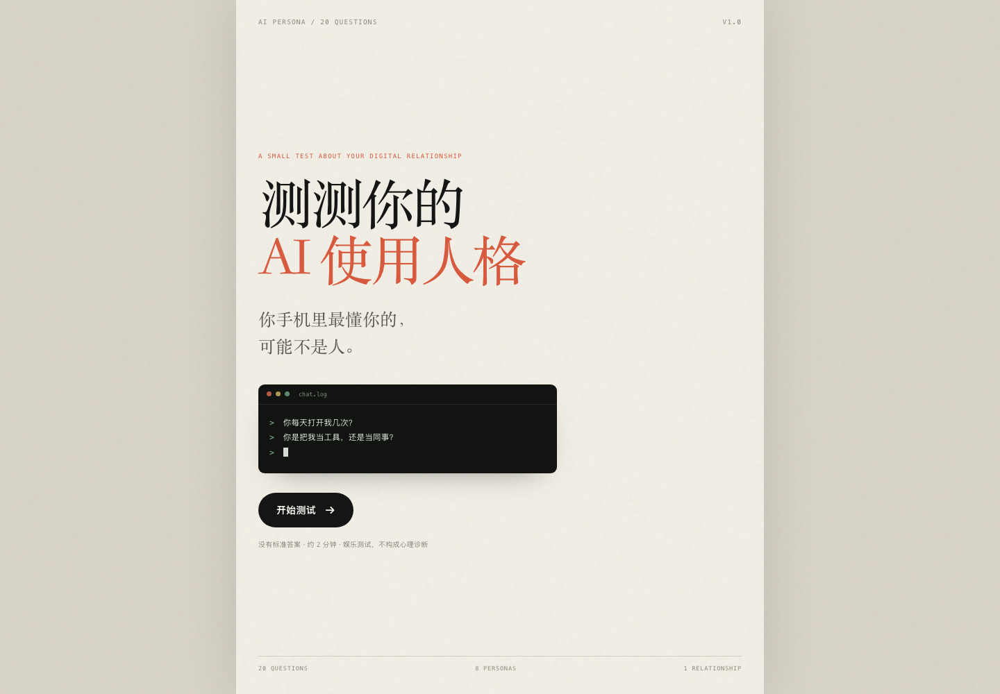
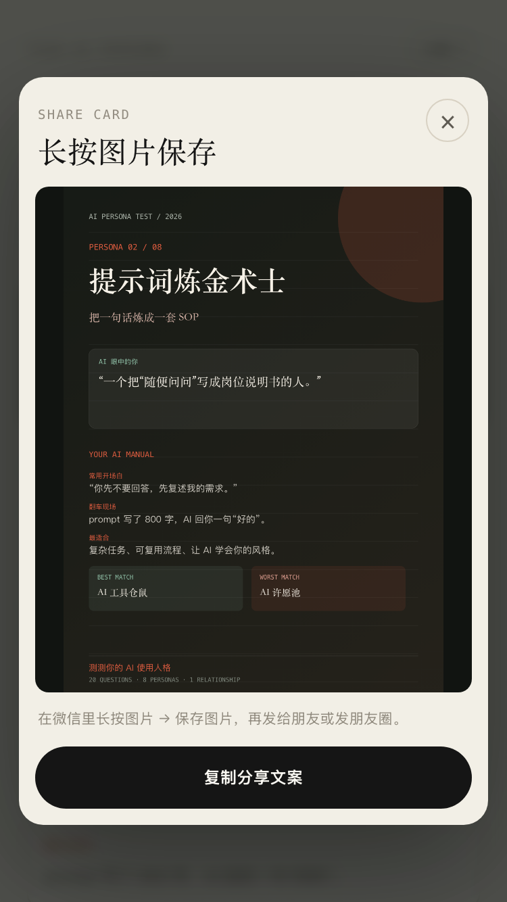

# 测测你的 AI 使用人格

一个 20 题的轻量人格测试：不测你会不会用 AI，测你和 AI 的关系。

- **20 道生活场景题**
- **8 种关系人格**
- **主结果 + 影子人格**
- **最佳搭子 / 最怕搭子**
- **可保存 1080×1440 分享卡**
- **手机微信传播优化**（长按保存分享图）





发布步骤见 [PUBLISH.md](PUBLISH.md)。

## 运行

这个目录是纯静态页面，没有后端、没有依赖。

```bash
cd ai-persona-test
python3 -m http.server 8780
```

打开：

```text
http://127.0.0.1:8780/
```

也可以直接双击 `index.html`，但本地 `file://` 下复制到剪贴板可能受浏览器限制，建议用本地服务器。

## 文件

```text
index.html      页面结构
styles.css      视觉样式（纸张 / 终端 / 聊天卡）
app.js          题目、8 个结果、计分、影子、分享卡
PUBLISH.md      网页版 GitHub Pages 发布步骤
cover.png       封面截图
quiz.png        答题页截图
result.png      结果页截图
result-mobile.png
mobile-cover.png / mobile-quiz.png / mobile-share.png
gallery.png     图鉴截图
card.png        分享卡示例
.nojekyll       GitHub Pages 用，防止 Jekyll 处理
```

## 微信里怎么传播

手机微信是主要场景，所以这版按“图片分享优先”做：

1. 答完题 → 点 **生成分享图**；
2. 页面弹出一张 1080×1440 的分享卡；
3. 在微信里**长按图片 → 保存图片**；
4. 把图片发到群里/朋友圈，或先保存再配文案。

微信内置浏览器里，顶部的 **分享 ↗** 也会直接打开分享卡，而不是调用系统分享（微信通常不支持 `navigator.share`）。

**关于链接卡片：** 微信里直接转发链接时，自定义标题/缩略图需要**公众号 + 微信 JS-SDK + 后端签名**。当前是纯静态页，没有这套后端，所以链接分享只能走“复制文案 + 链接”或“保存分享图”。这不是前端能单独解决的，后面如果要投公众号，再加签名服务。

页面已经做了这些移动端处理：

- `100svh` + `env(safe-area-inset-*)`，适配微信/iOS 底部安全区；
- 选项触控高度 ≥ 54px；
- 结果页按钮在手机上改为整行；
- 分享卡弹层单列、可滚动、图片可长按；
- 无横向滚动（390px / 375px 宽度已测）；
- 没有 hover 依赖，触屏可直接操作。

## 计分逻辑

每题 3 个选项，每个选项对应 1 个结果类型。

8 个类型：

```text
wish        AI 许愿池
alchemy     提示词炼金术士
editor      审稿型人类
copy        复制粘贴工程师
tree        树洞常驻民
skeptic     AI 怀疑论者
contractor  赛博包工头
hoarder     AI 工具仓鼠
```

因为每个类型在 20 题里出现的次数不同，直接用原始票数会让“选项多的类型”更容易赢。所以当前版本用**机会归一化**：

```text
类型得分 = 该类型被选中的次数 / 该类型在题库中出现的总次数
```

然后取最高分；如果第二名与第一名相差不超过 **0.07**，就把第二名作为“影子人格”。

当前每个类型的机会数：

| 类型 | 选项数 |
|---|---:|
| 许愿池 | 4 |
| 炼金术士 | 8 |
| 审稿型 | 11 |
| 复制粘贴 | 7 |
| 树洞 | 4 |
| 怀疑论者 | 11 |
| 赛博包工头 | 9 |
| 工具仓鼠 | 6 |

这不是心理测量学意义上的标准化；它是为娱乐测试做的权重修正。正式发布前建议收集 100–300 份真实结果，看分布是否过于集中，再微调选项映射。

## 关系图

| 结果 | 最佳搭子 | 最怕搭子 |
|---|---|---|
| AI 许愿池 | 提示词炼金术士 | 审稿型人类 |
| 提示词炼金术士 | AI 工具仓鼠 | AI 许愿池 |
| 审稿型人类 | 复制粘贴工程师 | 赛博包工头 |
| 复制粘贴工程师 | 审稿型人类 | 赛博包工头 |
| 树洞常驻民 | AI 怀疑论者 | 审稿型人类 |
| AI 怀疑论者 | 审稿型人类 | AI 许愿池 |
| 赛博包工头 | 提示词炼金术士 | AI 许愿池 |
| AI 工具仓鼠 | 提示词炼金术士 | AI 怀疑论者 |

## 怎么改

- 题目：改 `app.js` 里的 `QUESTIONS`，每题的 `options` 是 `[文案, 类型 key]`。
- 结果：改 `RESULTS`，每个结果有 `name/tagline/desc/manual/best/worst/eyes`。
- 机会数：`MAX_BY` 会自动从 `QUESTIONS` 重算，不用手改。
- 分享卡：改 `downloadCard()` 里的字号、颜色和布局。

## 部署到 GitHub Pages

1. 新建一个仓库，把本目录的文件放在仓库根目录；
2. 当前 `index.html` 已按下面这个地址配置：

   ```text
   https://reus1012.github.io/ai-persona-test/
   ```

   如果你的 GitHub 用户名或仓库名不同，搜索 `reus1012.github.io/ai-persona-test` 并替换成自己的地址（`og:image` 和 `og:url` 两处）。

3. 仓库 Settings → Pages → Source 选 `Deploy from a branch`；
4. Branch 选 `main`，目录选 `/ (root)`；
5. 保存后等待一分钟，页面会出现在：

   ```text
   https://你的用户名.github.io/ai-persona-test/
   ```

6. 用手机微信打开一次，完整走一遍“答题 → 生成分享图 → 长按保存”。

`.nojekyll` 已经放在目录里，避免 GitHub Pages 对静态文件做 Jekyll 处理。

如果要把链接分享卡做得更完整，需要在公众号后台配置 JS 安全域名，并用后端生成 `wx.config` 签名；那一步不属于这个静态测试的范围。

## 隐私

- 没有后端，不提交答案；
- 结果只存在当前页面内存里，刷新就没了；
- 分享按钮只发送结果文案和页面链接，不发送答题明细；
- 分享卡在浏览器本地绘制，不上传图片。

## 说明

这是一个娱乐测试，不是心理诊断，也不应该用来判断一个人“AI 用得好不好”。结果没有高低，只有你和 AI 的距离。
